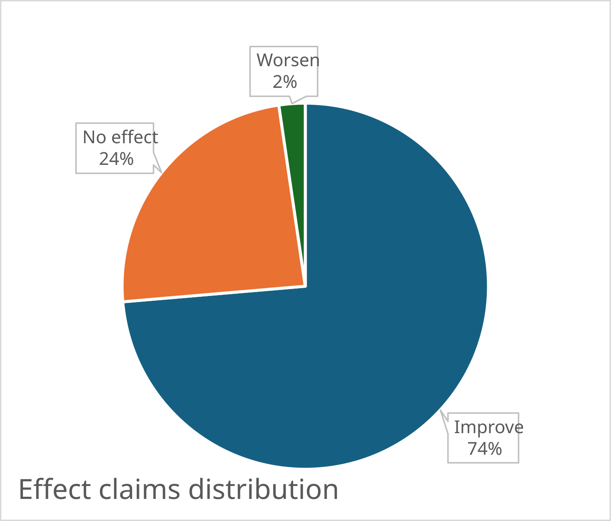
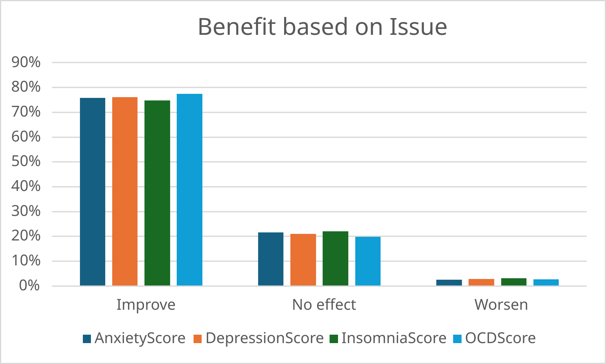

# How to Run

```sh
python -m pip install -r requirements.txt

# Make your choice
python -m pip install notebook jupyterlab

# Download the dataset
python ./setup.py 

jupyter lab eda.ipynb || jupyter notebook eda.ipynb
```

# Music and Mental health Exploratory Data Analysis using Excel
1. [Data preparation and cleaning phase](#data-preparation-phase)
2. [Asking questions](#questions-to-ask)
3. [Answers to the questions](#analysis)

## Data Preparation Phase
> Since this is exploratory analysis of a pre-prepared [dataset](https://www.kaggle.com/datasets/catherinerasgaitis/mxmh-survey-results) the [Asking](#questions-to-ask) comes later

#### Data summary
| **Column**                   | **Name Changed to** | **DataType**                                                                                                    | **Whatis?**                                 |
|------------------------------|---------------------|-----------------------------------------------------------------------------------------------------------------|---------------------------------------------|
| Timestamp                    | Timestamp           | DateTime                                                                                                        | Time of Submission                          |
| Age                          | Age                 | Integer                                                                                                         | Age of the Subject                          |
| Primary streaming service    | Service             | [Spotify, Pandora, YouTubeMusic, AppleMusic, Other, NoService]                                                  |                                             |
| Hours per day                | ListenTime          | Decimal(Hours per day)                                                                                          |                                             |
| While working                | OnWork              | [Yes, No]                                                                                                       | Do subject listen music while working       |
| Instrumentalist              | IsIns               | [Yes, No]                                                                                                       | Is the subject an Instrumentalist themselve |
| Composer                     | IsComp              | [Yes, No]                                                                                                       | Is the subject a Composer                   |
| Fav genre                    | FavGen              | [Classical, Country, EDM, Folk, Gospel, HipHop, Jazz, KPop, Latin, Lofi, Metal, Pop, R&B, Rap, Rock, VideoGame] | The favourite genre of the subject          |
| Exploratory                  | Exploratory         | [Yes, No]                                                                                                       |                                             |
| Foreign Languages            | Foreign             | [Yes, No]                                                                                                       |                                             |
| BPM                          | BPM                 | Integer                                                                                                         |                                             |
| Frequency [Classical]        | FrClassical         | [Never, Rarely, Sometimes, Very Frequently]                                                                     |                                             |
| Frequency [Country]          | FrCountry           | [Never, Rarely, Sometimes, Very Frequently]                                                                     |                                             |
| Frequency [EDM]              | FrEDM               | [Never, Rarely, Sometimes, Very Frequently]                                                                     |                                             |
| Frequency [Folk]             | FrFolk              | [Never, Rarely, Sometimes, Very Frequently]                                                                     |                                             |
| Frequency [Gospel]           | FrGospel            | [Never, Rarely, Sometimes, Very Frequently]                                                                     |                                             |
| Frequency [Hip hop]          | FrHipHop            | [Never, Rarely, Sometimes, Very Frequently]                                                                     |                                             |
| Frequency [Jazz]             | FrJazz              | [Never, Rarely, Sometimes, Very Frequently]                                                                     |                                             |
| Frequency [K pop]            | FrKPop              | [Never, Rarely, Sometimes, Very Frequently]                                                                     |                                             |
| Frequency [Latin]            | FrLatin             | [Never, Rarely, Sometimes, Very Frequently]                                                                     |                                             |
| Frequency [Lofi]             | FrLofi              | [Never, Rarely, Sometimes, Very Frequently]                                                                     |                                             |
| Frequency [Metal]            | FrMetal             | [Never, Rarely, Sometimes, Very Frequently]                                                                     |                                             |
| Frequency [Pop]              | FrPop               | [Never, Rarely, Sometimes, Very Frequently]                                                                     |                                             |
| Frequency [R&B]              | FrR&B               | [Never, Rarely, Sometimes, Very Frequently]                                                                     |                                             |
| Frequency [Rap]              | FrRap               | [Never, Rarely, Sometimes, Very Frequently]                                                                     |                                             |
| Frequency [Rock]             | FrRock              | [Never, Rarely, Sometimes, Very Frequently]                                                                     |                                             |
| Frequency [Video game music] | FrVideoGame         | [Never, Rarely, Sometimes, Very Frequently]                                                                     |                                             |
| Anxiety                      | AnxietyScore        | Integer(1-10)                                                                                                   | Subject reported score of there Anxiety     |
| Depression                   | DepressionScore     | Integer(1-10)                                                                                                   | Subject reported score of there Depression  |
| Insomnia                     | InsomniaScore       | Integer(1-10)                                                                                                   | Subject reported score of there Insomnia    |
| OCD                          | OCDScore            | Integer(1-10)                                                                                                   | Subject reported score of there OCD         |
| Music effects                | ObservedEffect      | [Improve, No effect, Worsen]                                                                                    |                                             |

#### Data Fixes
| **Anamoly**                                   | **Fix**                                                                                                                                                 |
|-----------------------------------------------|---------------------------------------------------------------------------------------------------------------------------------------------------------|
| 1 Blank Age value                             | Setting it to a Mean                                                                                                                                    |
| 1 Blank in Service                            | Setting to Other                                                                                                                                          |
| Some exaggerated reported hours in ListenTime | _NoFix_ Fall under Outlier                                                                                                                              |
| 3 Blanks in OnWork                            | Putting "Yes" if ListenTime is +8Hrs else "No"                                                                                                          |
| 4 Blanks in IsIns and 1 Blank in IsComp       | Considering them as "No"                                                                                                                                |
| 4 Blanks in Foreign                           | Setting them to "No"                                                                                                                                    |
| BPM's set to 999999999, 624, 0                | _NoFix_ for 0 Outliers, Setting highs to 300 as they interfere with histogram                                                                           |
| 107 Blanks in BPM                             | _NoFix_ These may have made difference, but cannot do anything. A data point which may go ignored. But seeing that it shows normal distribution it's ok |
| No Blanks in Frequency fields                 | _NoFix_ needed                                                                                                                                          |

#### Few Extra changes for Beauty points
1. Removing field `Timestamp`, `Foreign` and `Service`.
2. Changing field values in `FavGen`, 
    ("Video game music" to "VideoGame"),
    ("Hip hop" to "HipHop"),
    ("K pop" to "KPop")


## Questions to ask
1. How many percent of people claim Improvement in Mental Health [->](#the-percentage-of-people-claim-improvement-in-mental-health)
2. Does "Effect" corelates to Mental health issue (OCD, Insomnia, Depression, Anxiety) [->](#does-effect-co-relates-to-mental-health-issue)
3. Is there any genre of Music that has "No Effect" or high amount of "Effect"?
4. What age group benefited the most?
5. "Effect" and "No Effect" Correlation with BPM

## Analysis
#### The percentage of people claim Improvement in Mental Health


#### Does "Effect" co-relates to Mental health issue
* Many claim highscores in many different mental health issue. Need to separate them as to issue individually for everyone.
* So let's consider Issues with ">=3" and count effects for each issue.
* We see that effect does not change by the change in mental Issue.


